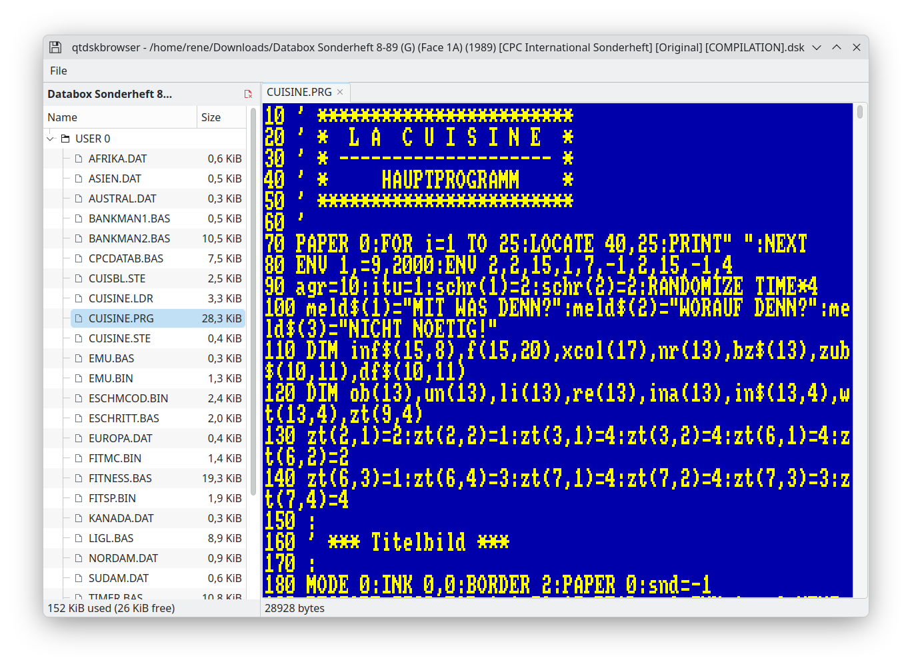

# qtdskbrowser

A Qt6 desktop application for browsing Amstrad CPC `.dsk` disk images. It
reads the AMSDOS directory (grouped by user number), lets you open `.BAS`
files directly from the disk, and detokenises/decrypts them (including
AMSDOS "protected" BASIC) for display in an authentic CPC-style view using
the original character ROM font.



## Requirements

- A C++17 compiler (GCC or Clang)
- [CMake](https://cmake.org/) 3.16 or newer
- Qt 6, with the **Widgets** module

On Debian/Ubuntu, the required packages can be installed with:

```bash
sudo apt install build-essential cmake qt6-base-dev
```

## Building

From the project root:

```bash
cmake -B build -S .
cmake --build build
```

The resulting executable is `build/qtdskbrowser`.

## Running

```bash
./build/qtdskbrowser
```

## Installing

To install the compiled binary to `/usr/local/bin`:

```bash
sudo cmake --install build
```

## Cross-compiling for Windows

A 64-bit Windows `.exe` can be built from Linux using the mingw-w64
cross-toolchain together with a Qt6 build for `win64_mingw`.

1. Install the mingw-w64 cross-compiler, and make sure it uses the `posix`
   threading model (required for Qt6's use of C++11 threads):

   ```bash
   sudo apt install mingw-w64
   sudo update-alternatives --set x86_64-w64-mingw32-gcc /usr/bin/x86_64-w64-mingw32-gcc-posix
   sudo update-alternatives --set x86_64-w64-mingw32-g++ /usr/bin/x86_64-w64-mingw32-g++-posix
   ```

2. Download a Qt6 build for `win64_mingw` using
   [aqtinstall](https://github.com/miurahr/aqtinstall) (there is no
   Debian/Ubuntu package for it):

   ```bash
   python3 -m venv ~/.venvs/aqt
   ~/.venvs/aqt/bin/pip install aqtinstall
   ~/.venvs/aqt/bin/aqt install-qt windows desktop 6.10.3 win64_mingw -O ~/Qt
   ```

   (6.10.3 is the newest Qt6 version with a published `win64_mingw` kit at
   the time of writing; run `aqt list-qt windows desktop --arch <version>`
   to check what's available for a different version.)

3. Configure and build using the toolchain file in `cmake/`, pointing
   `CMAKE_PREFIX_PATH` at the Qt installation from step 2:

   ```bash
   cmake -B build-windows -S . \
       -DCMAKE_TOOLCHAIN_FILE=cmake/mingw-w64-toolchain.cmake \
       -DCMAKE_PREFIX_PATH=~/Qt/6.10.3/mingw_64
   cmake --build build-windows
   ```

   The resulting executable is `build-windows/qtdskbrowser.exe`. (Qt6's own
   `moc`/`uic`/`rcc` only ship as Windows binaries in this kit, which can't
   run on Linux; the toolchain file points CMake at the native Qt6 install
   from the **Requirements** section above to run those instead, via
   `QT_HOST_PATH`.)

4. For a standalone `.exe` that runs on a machine without Qt installed, it
   needs to be bundled with its Qt DLLs using `windeployqt`. That tool is
   itself a Windows binary, so run it either on an actual Windows machine,
   or locally through [Wine](https://www.winehq.org/):

   ```bash
   sudo apt install wine64
   wine ~/Qt/6.10.3/mingw_64/bin/windeployqt.exe build-windows/qtdskbrowser.exe
   ```

## License notes

The character ROM font data in `cpcglyphs.h` is the Amstrad CPC's own
bitmap font (not a modern recreation); see
[`resources/LICENSE-cpc464.txt`](resources/LICENSE-cpc464.txt) for its
source and licensing details.
